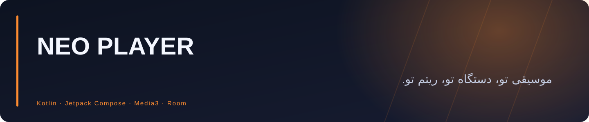
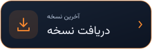
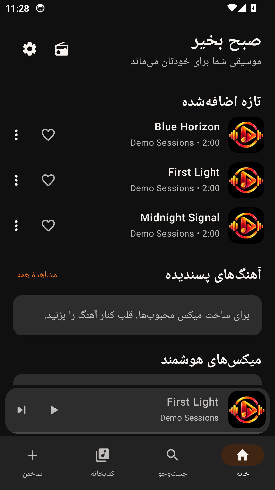
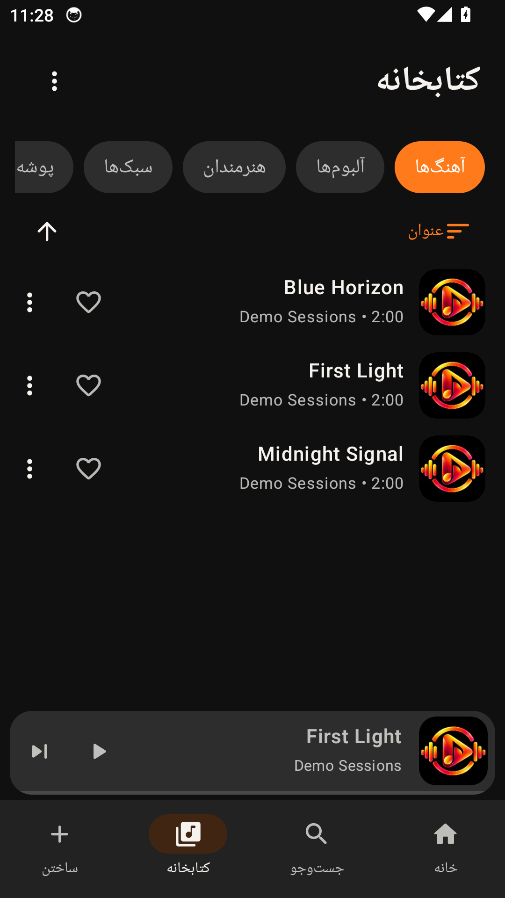
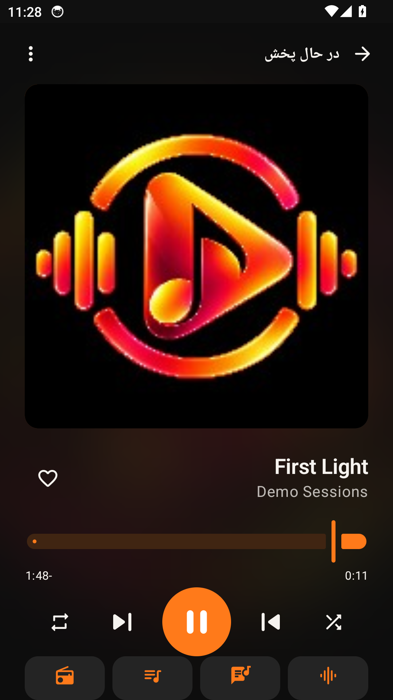
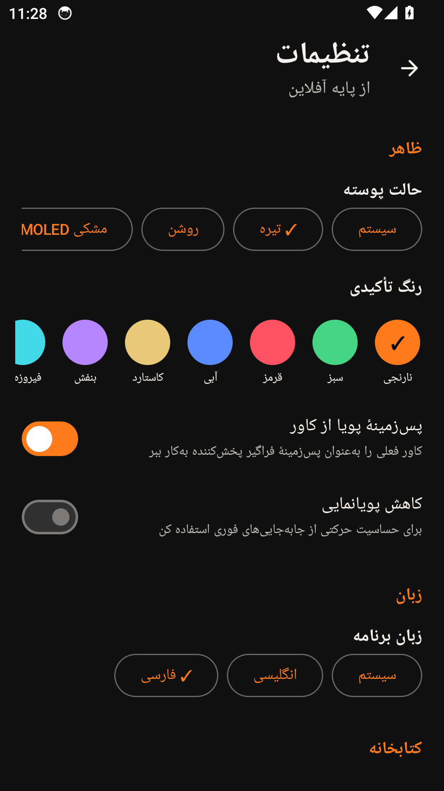

<div align="center">



**پخش‌کنندهٔ موسیقی اندروید با محوریت کتابخانهٔ محلی، شخصی‌سازی پخش، قابلیت‌های هوشمند آفلاین و رابط فارسی و انگلیسی.**


<a href="https://github.com/Realjustawall/neo-player/actions/workflows/android-alpha.yml"></a>

<a href="https://github.com/Realjustawall/neo-player/releases/latest"></a>
<a href="docs/gallery.fa.md"></a>
<a href="#quick-start"></a>
<a href="https://github.com/Realjustawall/neo-player/issues"></a>

[English](README.md) · [فارسی](README.fa.md)

</div>

---

[قابلیت‌های شاخص](#features) · [پیش‌نمایش](#preview) · [راه‌اندازی](#quick-start) · [توسعه](#development) · [مستندات](#documentation) · [امنیت و حریم خصوصی](#security) · [مجوز و بازخورد](#license)

<a id="features"></a>

## قابلیت‌های شاخص

| قابلیت | کاربرد |
|---|---|
| کتابخانهٔ محلی | آهنگ، آلبوم، هنرمند، پوشه، موردعلاقه‌ها و پلی‌لیست پایدار. |
| پخش | پخش مبتنی بر Media3، تنظیم پخش بدون فاصله، کراس‌فید دو رمزگشا، AutoMix و افکت‌های صدا. |
| Track+ | کاور، پس‌زمینه، ویدیوی Canvas، ویژوالایزر و پروفایل ظاهر برای هر آهنگ. |
| متن و هوش مصنوعی محلی | متن ساده و LRC، زمان‌بندی واژه‌ها و پیاده‌سازی اختیاری صدای فارسی و انگلیسی با Vosk. |
| ابزار آفلاین | حالت کاملاً آفلاین، پیشنهاد محلی، پشتیبان، پوشه‌بندی پلی‌لیست و ورود و خروج M3U8. |
| رادیوی محلی | میزبان و شنونده، پیوستن با QR و به‌روزرسانی زمان‌بندی همگام‌سازی. |

<a id="preview"></a>

## پیش‌نمایش

ثبت‌شده از APK رسمی و امضاشدهٔ اندروید v0.8.0-alpha، بدون تغییر برنامه، روی شبیه‌ساز Android API 34 با KVM در GitHub Actions. فایل‌های صوتی و تنظیم زبان، دادهٔ نمونهٔ موقت هستند.

<p align="center">



</p>

<details>
<summary>پیش‌نمایش تنظیمات</summary>



</details>

[مشاهدهٔ گالری کامل اندروید](docs/gallery.fa.md)

<a id="quick-start"></a>

## راه‌اندازی

۱. فایل **APK ریلیز** را از دکمهٔ بالا دریافت کنید.
۲. روی اندروید ۸ یا جدیدتر نصب کنید و هنگام درخواست، اجازهٔ دسترسی به کتابخانهٔ صوتی را بدهید.
۳. موسیقی‌های دستگاه را اسکن کنید، زبان را انتخاب کنید و پخش را آغاز کنید.
۴. برای کارکرد کاملاً آفلاین، فایل متن یا مدل محلی را وارد کنید یا مدل اختیاری را از قبل آماده کنید.

ساخت حساب لازم نیست. در ریلیز معمولی، مدل‌های هوش مصنوعی اختیاری هنگام نیاز دریافت می‌شوند؛ ساخت ویژه می‌تواند مدل‌ها را از ابتدا همراه داشته باشد.

<a id="development"></a>

## توسعه

JDK 17، Android SDK 36 و Gradle 8.13.

```bash
git clone https://github.com/Realjustawall/neo-player.git
cd neo-player
gradle assembleDebug
```

دستورهای بررسی:

```bash
gradle testDebugUnitTest
gradle lintRelease
gradle assembleRelease bundleRelease
```

ساخت اختیاری همراه مدل‌ها:

```bash
gradle -PNEO_EMBED_VOSK_MODELS=true assembleRelease bundleRelease
```

<a id="documentation"></a>

## مستندات

- [مرجع کامل قابلیت و ساخت](REFERENCE.md)
- [گردش‌کارهای ساخت](.github/workflows)
- [سورس برنامهٔ اندروید](app/src/main)

<a id="security"></a>

## امنیت و حریم خصوصی

تحلیل محلی، وضعیت کتابخانه و مدل نصب‌شده روی دستگاه اجرا می‌شوند. وقتی حالت کاملاً آفلاین خاموش است، آماده‌سازی اختیاری مدل یا ارائه‌دهنده می‌تواند به شبکه متصل شود. دسترسی صوتی برای فهرست‌سازی لازم است؛ فایل پشتیبان را در محل تحت کنترل خود نگه دارید.

<a id="license"></a>

## مجوز و بازخورد

تحت مجوز [Apache-2.0](LICENSE) منتشر می‌شود.

[گزارش اشکال و پیشنهاد بهبود](https://github.com/Realjustawall/neo-player/issues). نسخه، سیستم‌عامل و روش بازتولید را بنویسید و اطلاعات خصوصی یا رمزها را در گزارش قرار ندهید.

---

نگهداری توسط **[Realjustawall](https://github.com/Realjustawall)**.
