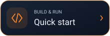

<div align="center">


**An Android music player built around your local library, expressive playback, offline intelligence and Persian/English interfaces.**


<a href="https://github.com/Realjustawall/neo-player/actions/workflows/android-alpha.yml"></a>

<a href="https://github.com/Realjustawall/neo-player/releases/latest"></a>
<a href="docs/gallery.en.md"></a>
<a href="#quick-start"></a>
<a href="https://github.com/Realjustawall/neo-player/issues"></a>

[English](README.md) · [فارسی](README.fa.md)

</div>

---

[Highlights](#features) · [Preview](#preview) · [Quick start](#quick-start) · [Development](#development) · [Documentation](#documentation) · [Security and privacy](#security) · [License and feedback](#license)

<a id="features"></a>

## Highlights

| Capability | What you get |
|---|---|
| Local library | Songs, albums, artists, folders, favorites and persistent playlists. |
| Playback | Media3 playback, gapless preference, dual-decoder crossfade, AutoMix and audio effects. |
| Track+ | Per-track artwork, wallpaper, Canvas video, visualizers and appearance profiles. |
| Lyrics and local AI | LRC/plain lyrics, word timing and optional Vosk-based English/Persian transcription. |
| Offline tools | Strict Offline, local recommendations, backup, playlist folders and M3U8 import/export. |
| Local Radio | Host/listener workflows with QR joining and refreshed synchronization timing. |

<a id="preview"></a>

## Preview

Fresh Android screenshots are pending. The [release evidence](https://github.com/Realjustawall/neo-player/releases/tag/v0.8.0-alpha) contains installation/launch verification; companion desktop images are not used as Android screenshots.

[Open the full gallery](docs/gallery.en.md)

<a id="quick-start"></a>

## Quick start

1. Download the **release APK** from the button above.
2. Install it on Android 8.0/API 26 or newer and grant audio-library access when prompted.
3. Scan your music, choose Persian or English and start listening.
4. Import local lyrics/model packs or prepare optional models before enabling Strict Offline.

No account is required. Normal releases obtain optional AI models on demand; an optional full-offline build can embed them.

<a id="development"></a>

## Development

JDK 17, Android SDK 36 and Gradle 8.13.

```bash
git clone https://github.com/Realjustawall/neo-player.git
cd neo-player
gradle assembleDebug
```

Validation commands:

```bash
gradle testDebugUnitTest
gradle lintRelease
gradle assembleRelease bundleRelease
```

Optional embedded-model build:

```bash
gradle -PNEO_EMBED_VOSK_MODELS=true assembleRelease bundleRelease
```

<a id="documentation"></a>

## Documentation

- [Complete feature/build reference](REFERENCE.md)
- [Build workflows](.github/workflows)
- [Android application source](app/src/main)

<a id="security"></a>

## Security and privacy

Local analysis, library state and installed AI models run on-device. Optional provider/model preparation can use the network when Strict Offline is disabled. Grant audio permissions for indexing and keep exported backups somewhere you control.

<a id="license"></a>

## License and feedback

Licensed under [Apache-2.0](LICENSE).

[Report bugs or discuss improvements](https://github.com/Realjustawall/neo-player/issues). Include your version, OS and reproducible steps; keep credentials and private data out of reports.

---

Maintained by **[Realjustawall](https://github.com/Realjustawall)**.
