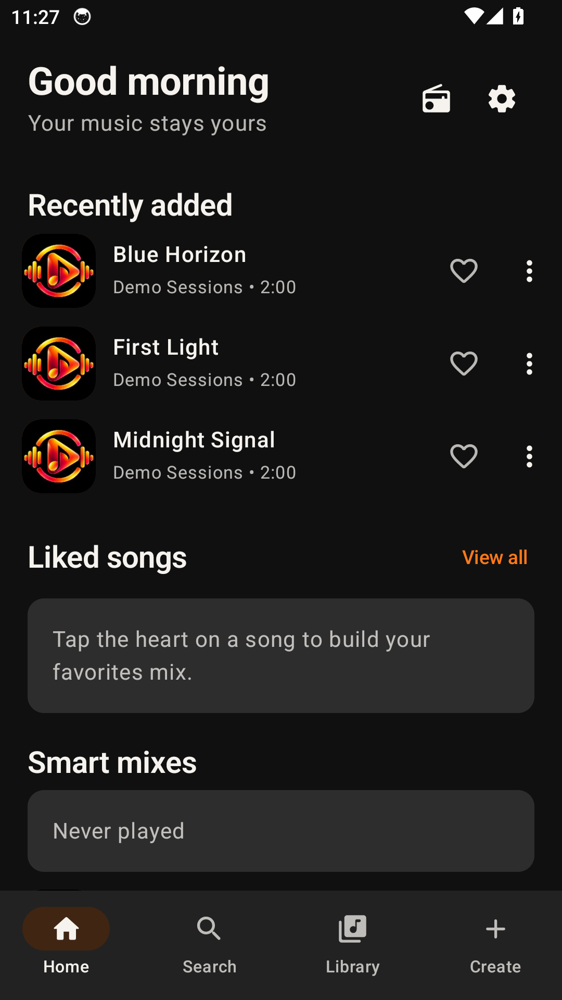
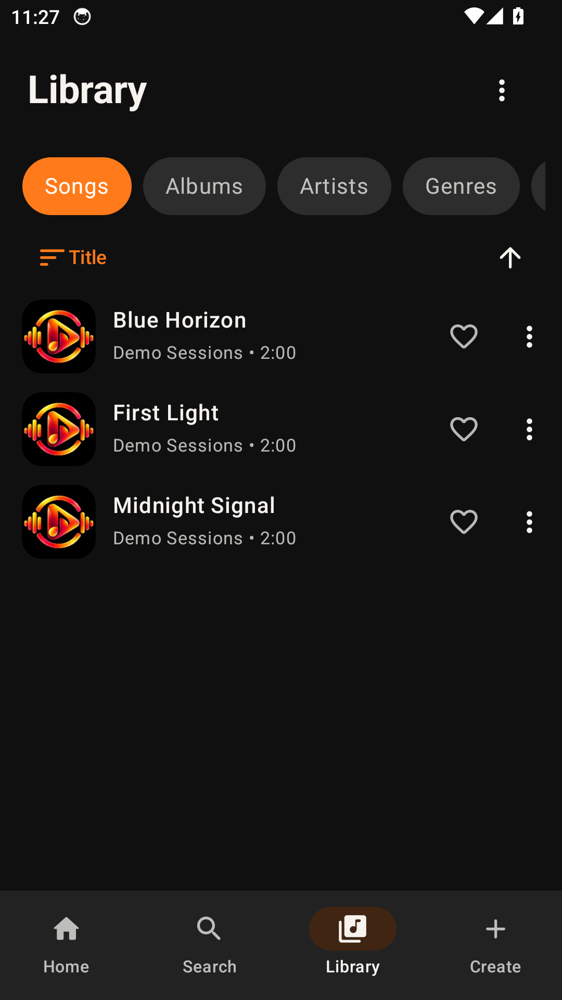
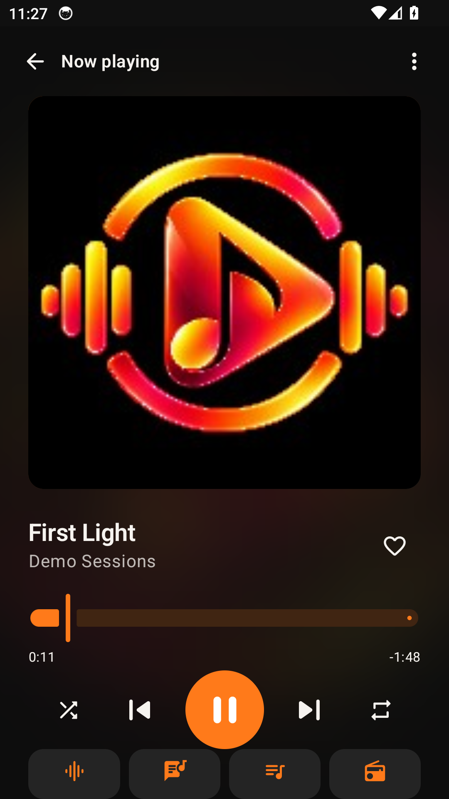
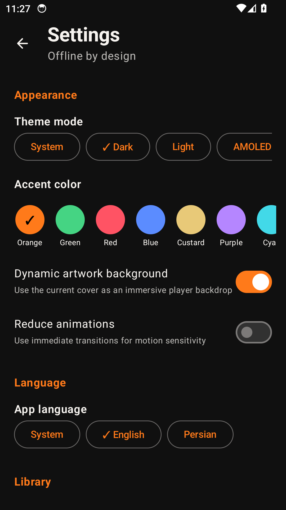

# NEO Player Android — Demo gallery

[English README](../README.md) · [فارسی](../README.fa.md)

Captured from the unmodified signed Android v0.8.0-alpha APK on an Android API 34 emulator with KVM in GitHub Actions. Local audio and language preferences are disposable demo fixtures.

## Home

## Local music library

## Now playing

## Settings and appearance

[Capture workflow / اجرای ثبت تصاویر](https://github.com/Realjustawall/neo-player/actions/runs/39770468394)
